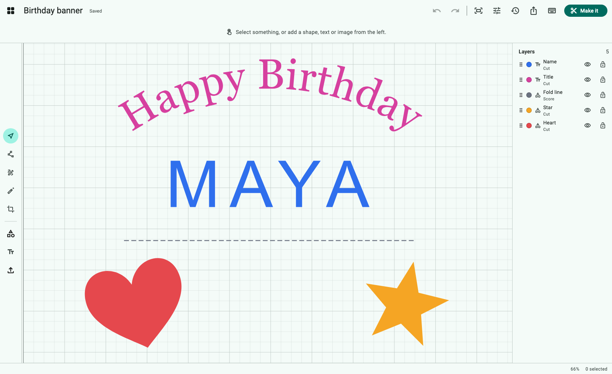
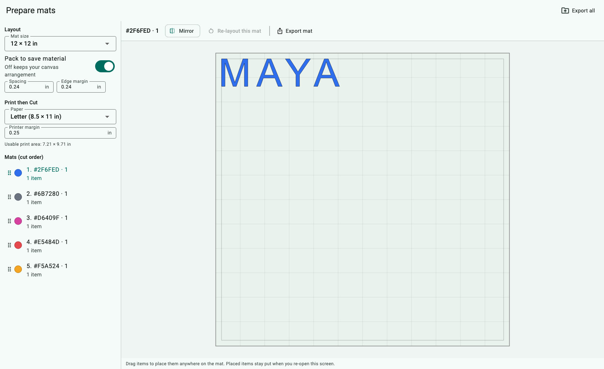
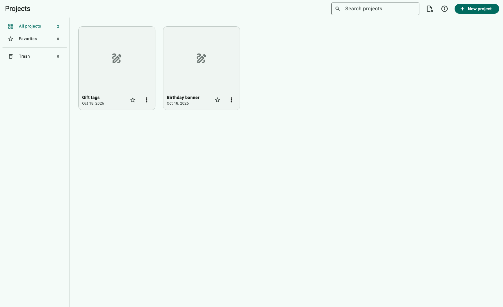

# Open Design Space

An open-source, offline-first design app for cutting machines, written in
Flutter. No account, no subscription, no upload limits. Your projects are plain
files on your computer.



> **Status: early alpha.** The design tools, mat layout and exports work and are
> tested, but output has not yet been checked on real cutting machines. Direct
> machine control isn't included (see [Cutting](#cutting)).

## Why

Open Design Space was built from public feedback about existing cutting-machine
software: lost work, forced cloud accounts, missing editing tools, rigid mat
layout and paywalled basics. See [docs/RESEARCH.md](docs/RESEARCH.md) for the
sources and [docs/PLAN.md](docs/PLAN.md) for how each complaint maps to a
feature.

| People asked for | Open Design Space |
| --- | --- |
| Don't lose my work | Autosave every second or two, atomic writes, restore points, and a trash you can restore from |
| Work offline, no account | Everything is local. Open `.odsx` JSON project files you can back up or move |
| Real editing tools | Node editing, pen, eraser, crop, weld, slice, intersect, subtract, offset, align, distribute, flip |
| Turn snapping off | Snapping is off by default and toggles in View |
| Better text | Uses your installed fonts, kerning, letter and line spacing, curve on multi-line text, outlines that don't destroy the text |
| Files open without the font | Text outlines are saved in the project, so it still shows and cuts |
| Control the mat | Drag items anywhere, choose mat order, auto-pack on or off, mirror per mat |
| Print then Cut on a full sheet | Choose the paper and printer margin, get registration marks and a PDF |
| Contour for imported images | Trace an image into a cut line, with an optional sticker border |
| Find my projects | Search, folders and favorites |
| Keyboard shortcuts, a stable UI | Full shortcuts (press the keyboard icon), an edit bar that never resizes the canvas, a blank canvas on launch |

## Screenshots

| Mats | Projects |
| --- | --- |
|  |  |

## Run it

You'll need [Flutter](https://docs.flutter.dev/get-started/install) 3.47 or newer.

```bash
flutter pub get
flutter run -d macos   # or windows, linux
```

Desktop is the main target. iOS and Android build, but on phones you add fonts
with **Import → Font**, since the app can't read the system fonts there. The web
build runs, but it keeps projects in memory only.

## Cutting

**Make it** lays the design out on mats, one per color, plus a Print then Cut
sheet. From there you can export each mat or all of them:

- **SVG**: works with most cutting software and Inkscape
- **DXF**: for CAD/CAM, laser and CNC tools
- **HPGL** (`.plt`): for generic plotters and vinyl cutters
- **PDF**: the Print then Cut sheet with registration marks. Print it at 100%.

Machine drivers implement a small interface,
[`CutterDriver`](lib/drivers/cutter_driver.dart), and are meant to live in
separate packages. Nothing in this repository talks to a specific
manufacturer's machine.

## Project layout

```text
lib/
  model/      document model: objects, geometry, project file format
  geometry/   booleans and offset (Clipper2), shapes, node editing, SVG import, image tracing
  text/       TrueType parser, font discovery, text layout
  mat/        mat planner (grouping, packing, manual placement, order)
  export/     SVG, PDF, DXF, HPGL
  storage/    local project store with snapshots and trash
  state/      editor controller (selection, undo, autosave, every edit operation)
  ui/         Flutter screens: editor, canvas, mats, library
test/         engine, editor and widget tests
```

Run the tests with `flutter test`. To regenerate the screenshots, run
`flutter test test/screenshots_test.dart --dart-define=SCREENSHOTS=true`.

## Clean-room note

This is an independent project. It isn't affiliated with or endorsed by Cricut,
Inc. or any other cutting-machine maker, and it contains none of their code,
assets, fonts or file formats. "Design Space" is used here only as a
description of what the app is for.

## License

[MIT](LICENSE)
